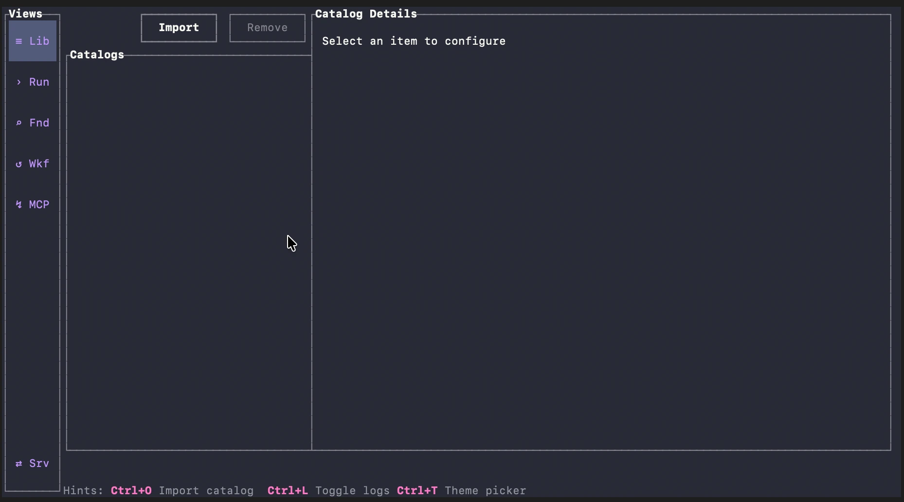

[](https://github.com/oattyio/oatty/actions/workflows/ci.yml)


# Oatty

**AI is changing how you build. You still own the system.**

The deployment passed, but the app still fails. The hosting domain changed, but the login callback didn't. Finding the cause means checking more than one service.

**Understand and operate your stack with Oatty.** Oatty brings API commands and MCP tools into one catalog for you and your agent. Check configuration across services, run the same commands in the terminal, and verify changes.

Free and open source. Built for engineers and their agents.

## Explore your environment

Start with one service, integration, or upcoming change:

- **What does this service connect to?** Ask your agent to compare configuration across services and show the values behind its answer.
- **What changed around this failure?** Use deployment history, audit events, or earlier snapshots. Current settings alone don't show what changed.
- **What should I check before changing this configuration?** Check the related services you know about and plan how to verify the change. Have the agent say which services it checked and what is still unknown.

[Connect your agent to Oatty](https://oatty.io/docs/api-access), then try a question about one service or integration. Ask it to show what it found, explain its conclusions, and say what it couldn't check. After a change, check the result in the services involved; a successful API response isn't enough.

Your catalog stays available for the next task. Add more services as you need them, reuse their commands, and save useful HTTP sequences as workflows. Commands and credentials still need maintenance; a catalog doesn't keep an automatic map of your environment.

Internal APIs fit here too. If a service has docs or request examples but no schema, your agent can write a supported OpenAPI document, validate and import it, and test the generated commands. Keep those commands alongside your vendor APIs. You can use what you learn to write code, tests, and infrastructure in your usual development tools.

Full documentation: https://oatty.io

- Quick Start: https://oatty.io/docs/quick-start
- Connect an agent to an API: https://oatty.io/docs/api-access
- Create an OpenAPI schema from documentation: https://oatty.io/docs/agent-authored-schema
- Correct a generated command: https://oatty.io/docs/repair-command
- Learn: https://oatty.io/docs/learn/getting-oriented
- Guides: https://oatty.io/docs/guides/sentry-bootstrap



## What Oatty Does

- Imports OpenAPI schemas and turns them into runnable commands.
- Lets you find and run commands and inspect results in a keyboard-first TUI.
- Exposes commands and workflows through MCP for connected agents.
- Uses search-first discovery so agents can inspect relevant commands without loading every imported operation as a separate tool.
- Supports reusable, reviewable API workflows using HTTP-backed commands.
- Includes several terminal themes.

## Install

### npm (recommended)

```bash
npm i -g oatty
oatty --help
```

### from source

```bash
cargo build --workspace
cargo run -p oatty -- --help
```

## Quick start

1. Launch TUI:

```bash
oatty
```

2. Import an OpenAPI catalog in Library (local file or URL).
3. Search commands in Run Command / Find.
4. Execute commands manually or with Workflows.
5. Use Workflows view to review and run multi-step operations.

For full walkthroughs: https://oatty.io/docs/quick-start

## CLI Basics

```bash
# Run TUI
oatty

# Run a command
oatty <group> <command> [flags]

# Import a catalog
oatty import <path-or-url>

# Workflow commands
oatty workflow list
oatty workflow preview --file workflows/example.yaml
```

## MCP and Agent Usage

Run Oatty as an MCP server so connected agents can discover and run catalog commands.

The agent supplies the reasoning; Oatty supplies the command catalog and execution tools. Return as the environment changes to inspect current state, test assumptions, and verify results. Agents and engineers can also carry tested interactions into maintained clients, tests, and infrastructure definitions in their development tools.

- MCP HTTP Server docs: https://oatty.io/docs/learn/mcp-http-server
- API access guide: https://oatty.io/docs/api-access
- Safety model: https://oatty.io/docs/learn/how-oatty-executes-safely

## Development

```bash
cargo fmt --all
cargo clippy --workspace -- -D warnings
cargo test --workspace
```

Architecture overview: [ARCHITECTURE.md](ARCHITECTURE.md)
Contributing guide: [CONTRIBUTING.md](CONTRIBUTING.md)
Release process: [RELEASE.md](RELEASE.md)

## License

Dual-licensed under MIT OR Apache-2.0.
